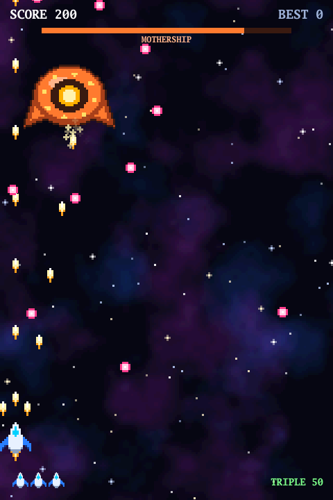

# Starfall

A retro space shooter written in [Bombo](https://github.com/RajaeDev6/bombo).



The whole game is [`game.bombo`](game.bombo), built on Bombo's `game` library, plus the pixel art and sound effects in [`assets/`](assets).

## Play

Install Bombo. It needs [Go](https://go.dev/dl/) 1.26 or newer. On Linux, see [Bombo's requirements](https://github.com/RajaeDev6/bombo#requirements) for a few extra packages.

```sh
go install github.com/RajaeDev6/bombo@latest
```

Then get the game and run it:

```sh
git clone https://github.com/RajaeDev6/starfall.git
cd starfall
bombo game.bombo
```

## Controls

| Key | Action |
|---|---|
| Arrows / WASD | Move |
| Space | Fire |
| P / Esc | Pause |

Clear the waves of drones, darts and gunships. Every fifth wave a mothership shows up. Enemies sometimes drop power-ups: triple shot, shield and an extra life. Your best score is saved between runs.

## Assets

| Folder | What's in it |
|---|---|
| `assets/images` | Ship, enemies, mothership, bullets, power-ups, shield, explosion frames, sparks, background and two star layers |
| `assets/sounds` | Shooting, hits, explosions, power-ups and short jingles, as `.wav` |
